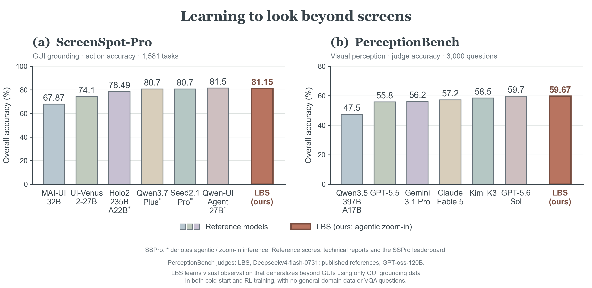
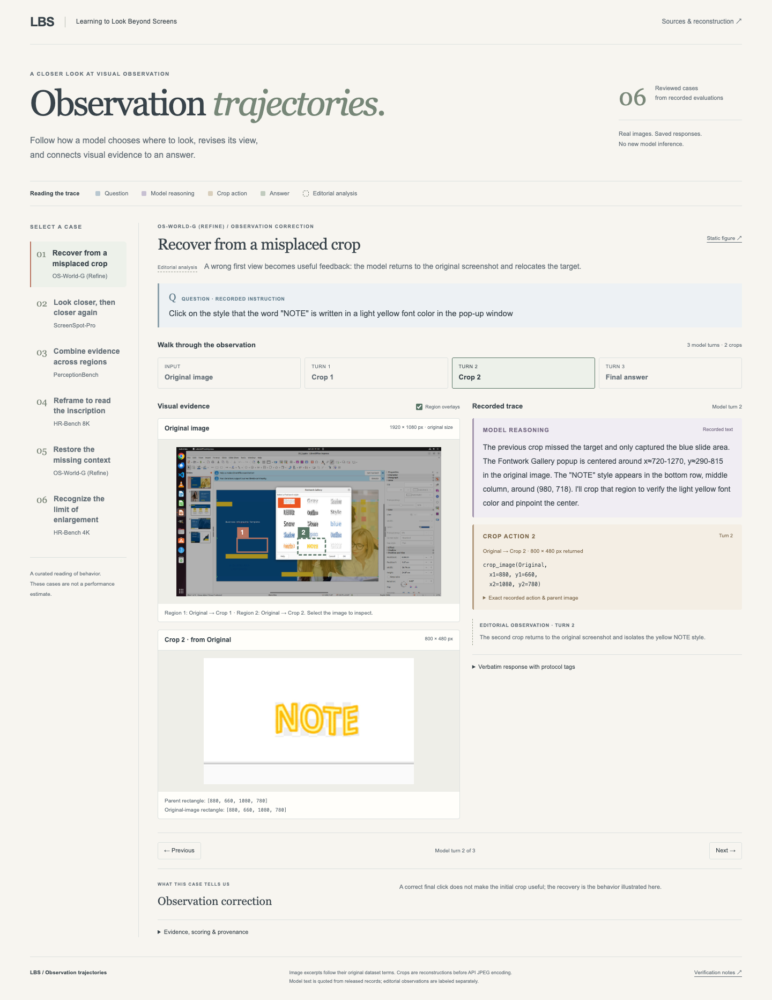
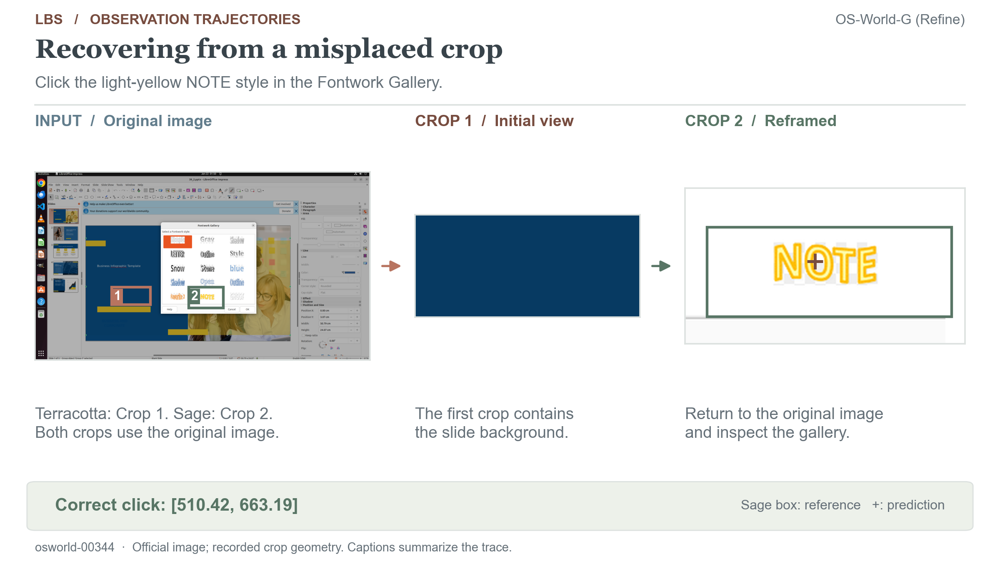
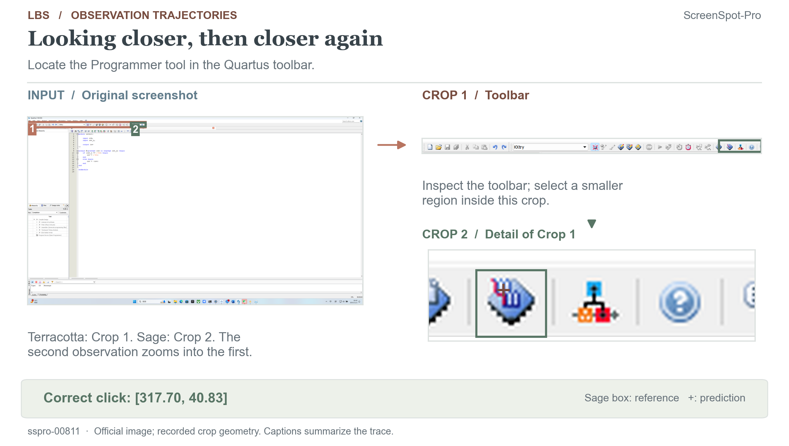
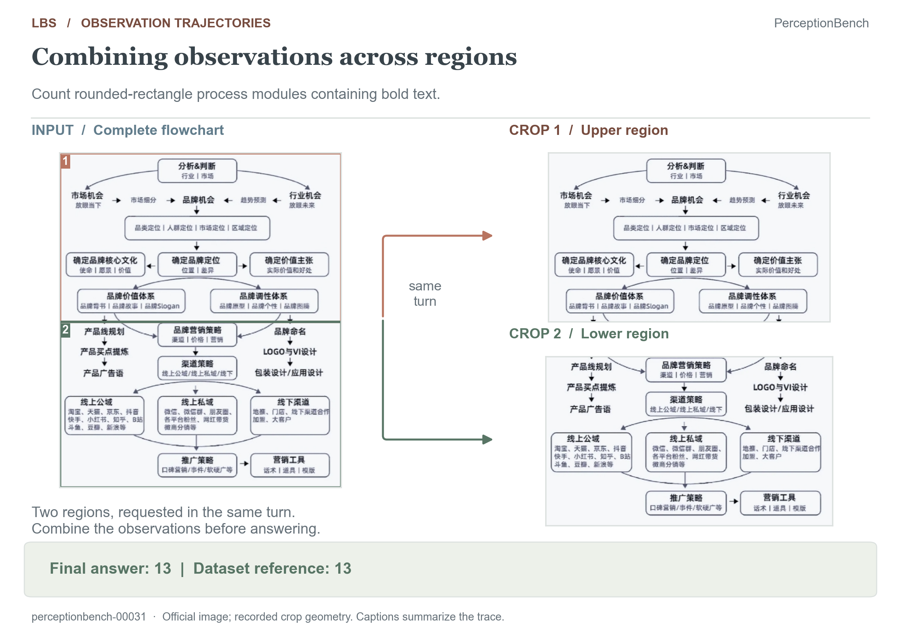
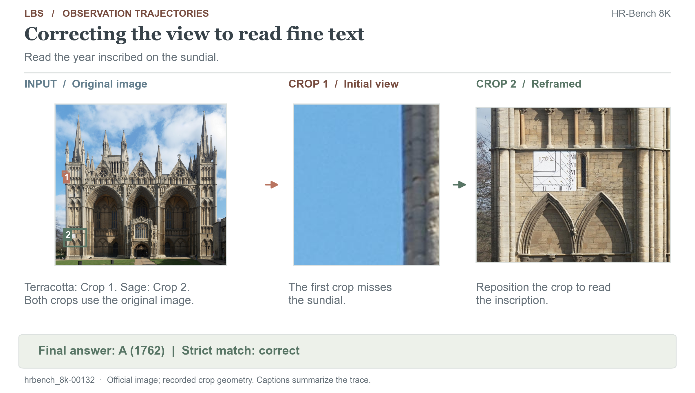

# Learning to Look Beyond Screens: Transferable Visual Observation from GUI Grounding

<p align="center">
  <strong>English</strong> | <a href="./README_CN.md">简体中文</a>
</p>

<p align="center">
  <a href="./LICENSE"></a>
  <a href="https://github.com/inclusionAI/UI-Venus/tree/LBS"></a>
  <a href="https://huggingface.co/inclusionAI/LBS-27B"></a>
  <a href="https://mr-bigworth.github.io/LBS/"></a>
</p>

[*Ruilin Yao*](https://mr-bigworth.github.io/)<sup>1,2,&#42;</sup>, [Xinyu Qiu](https://openreview.net/profile?id=~Xinyu_Qiu1)<sup>3,&#42;</sup>, [Tianyu Zou](https://openreview.net/profile?id=~Tianyu_Zou2)<sup>1</sup>, [Yi Rong](https://openreview.net/profile?id=~Yi_Rong3)<sup>1</sup>, [Shengwu Xiong](https://openreview.net/profile?id=~Shengwu_Xiong1)<sup>1</sup>, [Shuheng Shen](https://openreview.net/profile?id=~Shuheng_Shen2)<sup>4,†</sup>, [Changhua Meng](https://openreview.net/profile?id=~Changhua_Meng1)<sup>4</sup>

<sup>1</sup>Wuhan University of Technology &nbsp; <sup>2</sup>Institute of Automation, Chinese Academy of Sciences (CAS) &nbsp; <sup>3</sup>Zhejiang University &nbsp; <sup>4</sup>Ant Group

<sup>&#42;</sup> Core contributors. <sup>†</sup> Tech lead.

**LBS** provides a GRPO training recipe for learning visual observation through GUI
grounding, together with evaluation on GUI grounding and broader visual perception.
Our model is based on **Qwen3.8-27b**, trained with cold-start supervised fine-tuning
(**SFT**) followed by **Agentic RL (GRPO)**.

Model repository: [inclusionAI/LBS-27B](https://huggingface.co/inclusionAI/LBS-27B).
Model weights and the full training datasets are not bundled with this repository.
The technical report link and citation information will be added after the arXiv release.

[Training](agentic_gui_grounding_rl/) · [Evaluation](evaluation/) ·
[Results](benchmark_results/) · [Verified trajectories](docs/TRAJECTORIES.md) ·
[Live trajectory explorer](https://mr-bigworth.github.io/LBS/) ·
[Validation](docs/RELEASE_VALIDATION.md)

---

## Introduction



[Figure details and comparison sources](docs/BENCHMARK_OVERVIEW.md)

**From GUI grounding to visual perception:** LBS achieves **81.15%** overall action
accuracy on ScreenSpot-Pro and **59.67%** overall judge accuracy on PerceptionBench
with **agentic zoom-in**. Selected reference results are shown for context;
inference setups vary, and PerceptionBench uses different judges (ours:
Deepseekv4-flash-0731; upstream: GPT-oss-120B).
[Sources and comparison details](docs/BENCHMARK_OVERVIEW.md).

GUI screenshots put tiny, information-dense targets into a single high-resolution image.
Instead of answering a grounding question in one pass, an **agentic zoom-in** model
interacts with a simple visual environment: it reasons, asks to **zoom into regions of
interest** (`crop_image`), inspects the enlarged crops, and only then outputs its final
coordinate. Learning this observation policy on GUI tasks also enables the model to
inspect visual evidence beyond screenshots.

### Contributions

1. **Transferable visual observation from GUI grounding.** We show that
   **training exclusively on GUI grounding improves general-domain agentic VQA**,
   demonstrating transfer of the learned observation policy beyond screenshots.
   See [transfer in action](#transfer-observation-to-high-resolution-visual-qa).

2. **A compact training recipe with synthetic data.** Using only synthetic GUI
   grounding data, we train with approximately **10,000 cold-start SFT examples**,
   followed by **80 RL steps**, **batch size 64**, and **8 rollouts per prompt**.
   GRPO learns when and where to inspect using outcome-gated crop rewards and
   a per-call usage cost.
   [Training setup](agentic_gui_grounding_rl/README.md#reported-training-setup).

3. **A compositional zoom-in protocol.** The policy conditions on conversation
   history and references original images or earlier crops through explicit local
   `image_path` values. The protocol supports **nested refinement, revisiting earlier
   views, and batched zoom-in actions** that return multiple regions together,
   providing a common interface for flexible observation and multi-image extensions.
   Actions use plain assistant text and require no native tool-calling API.
   [Protocol and scope](#multi-turn-zoom-in-protocol).

4. **Open training and evaluation tools.** We release the
   [evaluation protocol](evaluation/README.md),
   [training plugin](agentic_gui_grounding_rl/plugins/grounding_zoom_in/README.md),
   and [training](agentic_gui_grounding_rl/data_samples/README.md) and
   [evaluation](benchmark_results/README.md) trajectory samples, with
   [verified visual examples](docs/TRAJECTORIES.md) and an
   [interactive explorer](https://mr-bigworth.github.io/LBS/). The tooling supports
   multi-node training and resumable evaluation with fixed protocol defaults
   against OpenAI-compatible serving endpoints.

The release includes the GRPO training recipe, evaluation clients, and recorded results:

| Component | Path | What it provides |
|---|---|---|
| **Training recipe** | [`agentic_gui_grounding_rl/`](agentic_gui_grounding_rl/) | Multi-turn **GRPO** reinforcement learning on top of [ms-swift](https://github.com/modelscope/ms-swift) + [vLLM](https://github.com/vllm-project/vllm), with a five-component reward (geometric + optional LLM-as-judge) and real data samples. Apache-2.0. |
| **Evaluation kit** | [`evaluation/`](evaluation/) | Standalone, resume-safe evaluation over **ScreenSpot-Pro / OS-World-G (Refine) / PerceptionBench / HR-Bench (4K+8K)** against any local `vllm serve` endpoint. |

## Results

These scores come from the complete recorded evaluation run. `released-checkpoint`
is a publication alias for the evaluated checkpoint; it is not a public model ID.

| Benchmark | Records | Reported metric | Score (%) |
|---|---:|---|---:|
| ScreenSpot-Pro | 1581 | Action accuracy | 81.15 |
| OS-World-G (Refine) | 564 | Action accuracy, including refusal | 84.57 |
| PerceptionBench | 3000 | Judge accuracy | 59.67 |
| HR-Bench 4K | 800 | **Strict option matching** | **89.13** |
| HR-Bench 8K | 800 | **Strict option matching** | **87.75** |

<details>
<summary>Evaluation protocols, reporting details, and trajectory selection</summary>

**OS-World-G (Refine)** uses `os-world-g-refine/annotation.json`: 470 bounding-box,
40 polygon, and 54 refusal records. The headline includes all 564 records.

**HR-Bench reporting uses strict matching, not LLM-as-a-judge scores.** Read
`hrbench.json → splits.HRBench4K.strict_accuracy` and
`hrbench.json → splits.HRBench8K.strict_accuracy` separately. Each split contains
200 question groups with four option rotations. The evaluator's existing parser,
strict-score computation, and additional judge metrics are preserved.

PerceptionBench uses a **self-hosted Deepseekv4-flash-0731** judge. LLM judging can
introduce randomness and serving variation; repeated judgments may differ. This
run has zero failed or skipped judgments. See [judge protocol notes](docs/JUDGE_PROTOCOL.md).

[Full results](benchmark_results/README.md) retain all aggregate and fine-grained
metrics and all 6745 per-item scores. Complete text trajectories are selected for
20 SSPro, 20 OS-World-G (Refine), 40 PerceptionBench, and 20 HR-Bench records (10 per split).
PerceptionBench includes four cases per category, with two successes and two
failures. These are curated illustrations, not a random performance estimate.

</details>

<!-- BEGIN RECORDED CATEGORY METRICS -->

### ScreenSpot-Pro: domains and target types

The six domains and 26 applications follow the [ScreenSpot-Pro grounding
leaderboard](https://gui-agent.github.io/grounding-leaderboard/). All values are
**action accuracy (%)**, computed over the complete 1581-record run. Text and
Icon use their respective target-type denominators; Overall is a **micro-average**
over records, rather than an average of domain or application scores. The
`Text / Icon` column gives the number of records of each type.

| Domain | Records | Text / Icon | Text (%) | Icon (%) | Overall (%) |
|---|---:|---:|---:|---:|---:|
| Development and Programming | 299 | 154 / 145 | 93.51 | 71.03 | 82.61 |
| Creative | 341 | 198 / 143 | 85.86 | 59.44 | 74.78 |
| CAD and Engineering | 261 | 197 / 64 | 83.25 | 59.38 | 77.39 |
| Scientific and Analytical | 254 | 144 / 110 | 92.36 | 65.45 | 80.71 |
| Office Suite | 230 | 177 / 53 | 96.61 | 81.13 | 93.04 |
| Operating System Commons | 196 | 107 / 89 | 92.52 | 68.54 | 81.63 |
| **All domains** | 1581 | 977 / 604 | 90.17 | 66.56 | 81.15 |

<details>
<summary>All 26 applications: sample counts and Text / Icon accuracy</summary>

| Domain | Application | Records | Text / Icon | Text (%) | Icon (%) | Overall (%) |
|---|---|---:|---:|---:|---:|---:|
| Development and Programming | Visual Studio Code | 55 | 33 / 22 | 93.94 | 90.91 | 92.73 |
| Development and Programming | PyCharm | 78 | 40 / 38 | 90.00 | 73.68 | 82.05 |
| Development and Programming | Android Studio | 80 | 36 / 44 | 94.44 | 59.09 | 75.00 |
| Development and Programming | Quartus | 45 | 13 / 32 | 100.00 | 65.62 | 75.56 |
| Development and Programming | VMware | 41 | 32 / 9 | 93.75 | 88.89 | 92.68 |
| Creative | Photoshop | 51 | 26 / 25 | 88.46 | 80.00 | 84.31 |
| Creative | Premiere | 52 | 28 / 24 | 78.57 | 70.83 | 75.00 |
| Creative | Illustrator | 31 | 12 / 19 | 100.00 | 47.37 | 67.74 |
| Creative | Blender | 71 | 56 / 15 | 82.14 | 73.33 | 80.28 |
| Creative | FL Studio | 57 | 26 / 31 | 80.77 | 41.94 | 59.65 |
| Creative | Unreal Engine | 35 | 29 / 6 | 93.10 | 50.00 | 85.71 |
| Creative | DaVinci Resolve | 44 | 21 / 23 | 90.48 | 52.17 | 70.45 |
| CAD and Engineering | AutoCAD | 34 | 27 / 7 | 88.89 | 0.00 | 70.59 |
| CAD and Engineering | SolidWorks | 77 | 63 / 14 | 76.19 | 85.71 | 77.92 |
| CAD and Engineering | Inventor | 70 | 59 / 11 | 83.05 | 54.55 | 78.57 |
| CAD and Engineering | Vivado | 80 | 48 / 32 | 89.58 | 62.50 | 78.75 |
| Scientific and Analytical | MATLAB | 93 | 74 / 19 | 89.19 | 84.21 | 88.17 |
| Scientific and Analytical | Origin | 62 | 19 / 43 | 89.47 | 51.16 | 62.90 |
| Scientific and Analytical | Stata | 49 | 8 / 41 | 100.00 | 65.85 | 71.43 |
| Scientific and Analytical | EViews | 50 | 43 / 7 | 97.67 | 100.00 | 98.00 |
| Office Suite | Word | 84 | 69 / 15 | 100.00 | 80.00 | 96.43 |
| Office Suite | PowerPoint | 82 | 57 / 25 | 96.49 | 84.00 | 92.68 |
| Office Suite | Excel | 64 | 51 / 13 | 92.16 | 76.92 | 89.06 |
| Operating System Commons | Windows | 81 | 34 / 47 | 94.12 | 72.34 | 81.48 |
| Operating System Commons | macOS | 65 | 42 / 23 | 97.62 | 60.87 | 84.62 |
| Operating System Commons | Linux | 50 | 31 / 19 | 83.87 | 68.42 | 78.00 |

</details>

Source: [saved SSPro metrics](benchmark_results/metrics/sspro.json) and
[all per-item scores](benchmark_results/per_sample/sspro.jsonl).

### PerceptionBench: ten perception categories

Category names, abbreviations, and order follow the [official PerceptionBench
leaderboard](https://github.com/MoonshotAI/PerceptionBench#leaderboard).
Scores below use our **self-hosted Deepseekv4-flash-0731** judge; the upstream
leaderboard uses GPT-oss-120B, so the judge configurations differ. LLM judgments
may vary across runs. These are the saved `judge_result` values used by the
published report; optional second judgments do not replace them.

| Category | Abbreviation | Records | Correct | Accuracy (%) |
|---|:---:|---:|---:|---:|
| Visual relation | VRel | 330 | 226 | 68.48 |
| Counting | Count | 330 | 204 | 61.82 |
| Attribute | Attr | 330 | 217 | 65.76 |
| Depth and 3D perception | Depth | 330 | 166 | 50.30 |
| Localization | Loc | 330 | 223 | 67.58 |
| Comparison | Comp | 279 | 177 | 63.44 |
| Fine-grained recognition | FGR | 290 | 167 | 57.59 |
| Contextual integration | Ctx | 255 | 134 | 52.55 |
| Optical character recognition | OCR | 255 | 157 | 61.57 |
| Perception-related hallucination | Hallu | 271 | 119 | 43.91 |
| **Overall** | — | **3000** | **1790** | **59.67** |

Overall is weighted by record count. There are **zero failed or skipped
judgments**, so all 3000 records contribute. Percentages retain the precision
of the saved report (accuracy rounded to four decimal places before conversion
to percent). Source: [category metrics](benchmark_results/metrics/perceptionbench.json)
and [all per-item scores](benchmark_results/per_sample/perceptionbench.jsonl).

<!-- END RECORDED CATEGORY METRICS -->

## Observation trajectories

Explore the six visually reviewed cases in the
[interactive HTML explorer](https://mr-bigworth.github.io/LBS/): switch model turns
to align recorded reasoning, crop actions, returned images, and final answers.
A muted Morandi palette distinguishes questions, reasoning, actions, and answers;
editorial analysis is labeled separately from model text. Click the preview below
to open the live interactive page. See [source and local preview instructions](docs/TRAJECTORIES.md#interactive-html-explorer).

<p align="center">
  <strong>Interactive trajectory visualization</strong><br>
  <a href="https://mr-bigworth.github.io/LBS/"></a><br>
  <a href="https://mr-bigworth.github.io/LBS/"><strong>Open the live trajectory explorer ↗</strong></a>
</p>

The following figures were checked against the downloaded official images,
recorded tool events, and saved judgments. Crops are reconstructed from the recorded
parent-image rectangles and resizing rules; captions summarize the actual trace.
Sage boxes in final GUI crops mark the reference target; terracotta crosses mark the
recorded prediction. No model was rerun to create these figures.
Terracotta and sage identify the first and second crops. Arrows show the observation
sequence; the PerceptionBench branch shows two crops requested in the same turn.

### Recover from an incorrect observation

The first crop shows only the blue slide background. The model identifies the
miss, returns to the original screenshot, and crops the Fontwork Gallery target.



[Complete OS-World-G (Refine) trajectory](benchmark_results/trajectories/osworld/osworld-00344.json)

### Inspect a crop at a finer scale

The model first inspects the toolbar, then crops that returned image again to
resolve the small Programmer icon. The final point falls inside the reference box.



[Complete ScreenSpot-Pro trajectory](benchmark_results/trajectories/sspro/sspro-00811.json)

### Combine evidence from different regions

The model inspects the upper and lower halves of a flowchart in the same turn,
then combines the observations to count 13 rounded-rectangle process modules.



[Complete PerceptionBench trajectory](benchmark_results/trajectories/perceptionbench/perceptionbench-00031.json)

### Transfer observation to high-resolution visual QA

The first crop misses the sundial. After recognizing the misplaced view, the model
repositions the crop and reads **1762**, matching the reference option under strict scoring.



[Complete HR-Bench 8K trajectory](benchmark_results/trajectories/hrbench_8k/hrbench_8k-00132.json)

[More cases, sources, and reconstruction details](docs/TRAJECTORIES.md).

## Method

### Multi-turn zoom-in protocol

Observation decisions use the accumulated conversation, including earlier images,
actions, and crop feedback. Each `image_path` identifies an image in the episode's
local registry, allowing the policy to [refine a previous crop](#inspect-a-crop-at-a-finer-scale),
[revisit the original image](#recover-from-an-incorrect-observation), or
[inspect multiple regions in one turn](#combine-evidence-from-different-regions).
Here, **free-form zoom-in** means adaptive selection of regions and observation
order within a fixed action grammar and crop budget.

For GUI grounding, each episode follows this conversation structure:

1. **system** — task instruction, original-image metadata, `crop_image` action spec,
   answer format (`[x.xx,y.yy]` normalized to [0,1000] on the original image).
2. **user** — `image_path: ...` + the original screenshot.
3. **assistant** — visible `<think>` reasoning, then one or two independent
   `<action>crop_image(...)</action>` blocks (or the final coordinate). Actions
   in a batch reference images available before that turn.
4. **user** — all crop results returned together in action order: new image
   paths/sizes, regions in parent and original coordinates, and resized crop
   images. Crops are PIL-executed (LANCZOS, 4× upscale, capped at 4M pixels),
   may be nested, and always carry an explicit mapping back to original-image
   coordinates.
5. Repeat until the final answer. Budgets: at most **3** crops in total, **2** per
   turn. Training, SSPro, and PerceptionBench default to **2** format-correction
   rounds (`MAX_TURNS = 6` for training); HR-Bench defaults to **4** correction
   rounds. These benchmark-specific defaults are preserved.

<details>
<summary>Example: one crop and a final grounding point</summary>

```text
User:                      image_path: screenshot.png <image>   ← original screenshot
Assistant:  <think>small target, zoom in</think>
           <action>crop_image(image_path="screenshot.png",
                              x1=560.00, y1=150.00, x2=844.00, y2=240.00)</action>
User:                      crop result (resized crop <image> + metadata + mapping)
Assistant:  <think>found it</think>
           [798.23,457.17]                     ← final point, [0,1000] on the ORIGINAL image
```

</details>

<details>
<summary>Scope and relation to prior work</summary>

**Implemented scope.** Batched zoom-in groups up to two independent crop actions
in one assistant turn and returns their results in one user message; crop execution
is sequential. Paths serve as explicit image references resolved by the local
executor; image content is also supplied to the model. The
[PerceptionBench QA interface](evaluation/perceptionbench/eval_perceptionbench_agentic.py)
already accepts multiple original images. GUI training and grounding evaluation
start from one original image; extending them to multiple originals would require
corresponding task, answer, and reward definitions. The reported results do not
isolate performance on multi-image tasks.

**Research context.** [DeepEyes](https://arxiv.org/abs/2505.14362) and
[Pixel Reasoner](https://arxiv.org/abs/2505.15966) study visual tool use learned
through RL. [Visual Sketchpad](https://arxiv.org/abs/2406.09403) and
[PyVision](https://arxiv.org/abs/2507.07998) support flexible visual manipulation
through code. Our protocol contribution is the integration of explicit image
references, coordinate mappings, and action batches into a shared interface for
GUI-grounding training and visual-perception evaluation. The recorded trajectories
illustrate these capabilities; their individual effects require controlled ablations.

</details>

### Training: GRPO over crop trajectories

- A custom `MultiTurnScheduler` drives the conversation inside a vLLM rollout server;
  the trainer assigns **trajectory-level GRPO advantages**.
- **Five-component reward** — four deterministic geometric components plus an optional
  LLM-as-judge for reasoning quality:

| Reward | Type | Signal |
|---|---|---|
| `zoomin_accuracy` | ORM | Final point inside GT bbox (0/1) — the main outcome signal |
| `zoomin_crop_process_gated` | ORM | Outcome-gated best-crop IoU, minus repeat/no-improve penalties, minus a per-call usage cost (default 0.05) |
| `zoomin_format` | ORM | Protocol compliance of the final assistant turn |
| `zoomin_zoom_bonus` | ORM | Extra credit for correct answers earned *through* effective zooming on hard samples |
| `zoomin_cot_rm` | AsyncORM | Optional LLM-as-judge CoT score over the text-only transcript, **accuracy-gated** against reward hacking; talks to any OpenAI-compatible endpoint; skips judge requests and uses a neutral score when unconfigured |

- **Turn-level loss shaping**: heuristic PRM filtering of bad crop decisions and an
  uncertainty (entropy) filter mask low-value intermediate turns, while every assistant
  turn keeps its exact rollout tokens for importance-sampling correction.
- **Engineering robustness**: NaN/Inf output sanitization, crops transferred as base64
  data URIs (no shared filesystem between rollout and training nodes), and a tolerant
  multi-dialect action parser.

### Evaluation: fixed-protocol benchmarks, local endpoints

The eval kit measures trained checkpoints on four benchmarks through one local
`vllm serve` OpenAI-compatible endpoint, with checkpoint/resume built into every stage:

| Benchmark | Size | Judging | Headline metric |
|---|---|---|---|
| ScreenSpot-Pro | 1581 | Local geometric (point-in-bbox) | `sspro.json → metrics.overall.action_acc` |
| OS-World-G (Refine) | 564 (510 positive + 54 refusal) | Local + refusal-behavior stats | `osworld.json → metrics.overall.action_acc` |
| PerceptionBench | 3000 | LLM judge (any OpenAI-compatible endpoint, env-configured) | `perceptionbench_scores.json → overall` |
| HR-Bench 4K / 8K | 800 each | Strict option matching | `hrbench.json → splits.HRBench4K.strict_accuracy` / `splits.HRBench8K.strict_accuracy` |

## Training data and recorded rollouts

We provide both **training input examples** and **rollout trajectories recorded
during a real GRPO training run**:

| Sample | Records | Unique original images | Contents |
|---|---:|---:|---|
| [GRPO training inputs](agentic_gui_grounding_rl/data_samples/grpo_train_prompts/train_prompts_head8.jsonl) | 8 | 8 | Prompt-only examples with task instructions, screenshot references, and ground-truth bounding boxes used by the reward. |
| [Recorded training rollouts](agentic_gui_grounding_rl/data_samples/rollout_trajectories/rollout_trajectories_head32.jsonl) | 32 | 4 | Multi-turn model reasoning, crop actions and feedback, final responses, rewards, and GRPO advantages. |

The **32 rollouts = 4 distinct prompts × 8 generations per prompt**, taken from
training step 1. Each group shares one original screenshot, explaining why the
`originals/` directory contains **4 images**. The JSONL contains 32 separate,
distinct conversation records: `prompt_group` identifies the four groups and
`generation` ranges from 0 to 7 within each group. These grouped records allow
inspection of different observation decisions, rewards, and advantages for the
same task.

The model text and training values come from saved training logs, with the
documented anonymization. The 47 crop images were reconstructed offline from
recorded geometry using the training protocol. See the
[sample guide](agentic_gui_grounding_rl/data_samples/README.md) for schemas,
provenance, and loading instructions.

## Repository layout

```text
├── agentic_gui_grounding_rl/       # GRPO recipe, plugin, and real training samples
├── evaluation/                    # Four-benchmark evaluation kit
│   ├── common/                    # Shared text-action pipeline
│   ├── sspro/                     # ScreenSpot-Pro and OS-World-G (Refine)
│   ├── perceptionbench/           # VQA pipeline and judge
│   ├── hrbench/                   # MCQ evaluation and strict scoring
│   └── scripts/                   # Data preparation, serving, and runners
├── benchmark_results/             # Full metrics/scores; 100 selected trajectories
├── docs/                          # Judge notes, verified cases, and figure assets
├── scripts/                       # Offline publication tools; optional for training/evaluation
├── tests/                         # Offline evaluation completion/resume/shard regressions
├── AGENTS.md                      # Contributor and agent instructions
└── LICENSE / NOTICE               # Apache-2.0 and third-party attribution
```

Downloaded benchmark data and raw runs are local artifacts excluded from Git and
release packages. Curated results are separate from runtime output directories.

Each component has its own detailed README; this document is the entry point.

### Runtime and publication scripts

Training starts with `agentic_gui_grounding_rl/train_zoomin_grounding_grpo.sh`;
evaluation runners, serving, data preparation, and finalizers live in
`evaluation/scripts/`. Neither runtime invokes the repository-root `scripts/`.
Those six optional offline tools reproduce or check the published results:

| Root script | Purpose and relationship to evaluation |
|---|---|
| `export_release.py` | Export recorded metrics, scores, and selected sanitized trajectories; no inference or scoring changes. |
| `validate_release.py` | Check publication artifacts and sample files; optionally compare saved metrics and replay scoring with the current evaluators. |
| `render_metric_tables.py` | Rebuild or check README tables from recorded evaluation metrics and scores. |
| `render_benchmark_overview.py` | Render the introduction bar chart from saved overall scores and frozen published references. |
| `render_trajectories.py` | Reconstruct reviewed crops with the evaluation crop executor and render figures. |
| `export_trajectory_html.py` | Export the interactive viewer; image regeneration reuses the same checked crop reconstruction. |

`tests/test_runtime_contracts.py` covers evaluation failure/resume, report
completeness, PB shard compatibility, and wrapper configuration with local model
stubs. It requires no live model or GPU. See [offline checks](docs/RELEASE_VALIDATION.md).

## Installation

Check out the `LBS` branch and create an environment for the evaluation clients:

```bash
git clone --branch LBS --single-branch https://github.com/inclusionAI/UI-Venus.git
cd UI-Venus
python3 -m venv .venv
source .venv/bin/activate
python3 -m pip install -r evaluation/requirements.txt
```

Evaluation clients require Python 3.10 or newer and no training framework. Training
and model serving require separate, compatible ms-swift/vLLM environments and
sufficient device memory for the selected model, image resolution, context length,
and rollout configuration. Install training dependencies in the training environment:

```bash
python3 -m pip install ms-swift vllm deepspeed pillow qwen-vl-utils
python3 -m pip install openai  # only for the optional CoT judge reward
```

## Quick start

Start from the repository root in the appropriate environment. Training and
evaluation can be used independently; the serving and evaluation steps below
assume an existing checkpoint.

### 1. Train (single-node smoke test)

The training component ships an 8-row sample dataset for a smoke test after
installing the training dependencies and configuring the Qwen3.8-27b SFT checkpoint.
`/models/qwen3.8-27b-sft` is an illustrative local path to the checkpoint after
cold-start SFT, used to initialize Agentic RL. Adjust device topology for your hardware:

```bash
(
  cd agentic_gui_grounding_rl
  MODEL_PATH=/models/qwen3.8-27b-sft NNODES=1 VLLM_TP=1 \
    bash train_zoomin_grounding_grpo.sh
)
```

For real runs, provide your own jsonl rows
(`{"problem": "<image>...", "solution": "[x1,y1,x2,y2]", "images": ["a.png"]}`) via the
`DATASETS` env var, and scale out with `NNODES` / `NODE_RANK` / `ROLLOUT_NNODES`
(see the script header and the
[training README](agentic_gui_grounding_rl/README.md) for the multi-node topology).

### 2. Serve a checkpoint

Use the LBS checkpoint obtained after SFT and Agentic RL on Qwen3.8-27b.
`/path/to/checkpoint` below denotes its local directory.

```bash
cd evaluation
bash scripts/serve_vllm.sh start /path/to/checkpoint --name evaluated-model --tp 4 --dp 1 --daemon
cp .env.example .env.run
# Set OPENAI_BASE_URL and MODEL to match the running service.
# Use the model ID from /v1/models; .env.vllm.evaluated-model records this service.
# Configure JUDGE_API_KEY, JUDGE_BASE_URL, and JUDGE_MODEL for PerceptionBench.
bash scripts/fetch_data.sh all
```

### 3. Evaluate (all four benchmarks)

Continue from `evaluation/` with `.env.run` configured. Set concurrency to fit
your endpoint capacity; PerceptionBench uses `PB_NUM_SHARDS * PB_SHARD_CONCURRENCY`
concurrent requests.

```bash
bash scripts/run_all.sh .env.run results/run-name          # full chain, serial
# or individually:
bash scripts/run_sspro.sh           .env.run results/run-name
bash scripts/run_osworld.sh         .env.run results/run-name
bash scripts/run_perceptionbench.sh .env.run results/run-name 8
bash scripts/run_hrbench.sh         .env.run results/run-name
```

Rerun the same command with the same configuration to resume after an interruption.
Use a new results directory when changing the configuration. PerceptionBench
predictions can be judged later
(`PB_SKIP_JUDGE=1 FINALIZE=0 CLEAN_INTERMEDIATES=0`, followed by rejudging
each retained shard and finalizing with `--keep-shards`). See the
[eval-kit README](evaluation/README.md) for smoke tests,
result artifacts, and troubleshooting.

### 4. Inference with any OpenAI-compatible client

After training, serve the model with vLLM and drive it with the plain OpenAI SDK —
parse `<action>crop_image(...)</action>` from responses and execute crops client-side
(`zoomin_grounding_protocol.execute_crop`), or let ms-swift's rollout server run the
loop for you. A first-turn client example and crop-loop notes are in the
[training README](agentic_gui_grounding_rl/README.md#serving--inference-openai-compatible-endpoints).

## Data and use scope

Benchmark excerpts included in this repository are used solely to display recorded
evaluation results and observation trajectories, with no other use intended.
Their original ownership, licenses, and terms remain unchanged; the repository's
Apache-2.0 software license does not relicense them. Sources are credited in
[NOTICE](NOTICE) and the [trajectory documentation](docs/TRAJECTORIES.md).

- **Training samples** (`agentic_gui_grounding_rl/data_samples/`): 8 prompt-only GRPO
  rows + 32 complete multi-turn trajectories (4 prompts × 8 generations) from a real
  training run, anonymized and directly loadable by ms-swift or any OpenAI-compatible
  endpoint. Sample screenshots retain their original ownership and terms.
- **Benchmark data**: ScreenSpot-Pro, OS-World-G (Refine), PerceptionBench and HR-Bench are
  third-party benchmarks and remain subject to their original licenses and terms of
  use. Complete datasets are downloaded separately into the ignored
  `evaluation/data/` directory. Fetch and verify the data from official sources:

  ```bash
  pip install -U "huggingface_hub[cli]"        # only needed for fetching
  cd evaluation
  scripts/fetch_data.sh all                    # download (~11G) + convert + verify
  ```

  | Benchmark | Official source | Size |
  |---|---|---|
  | ScreenSpot-Pro | [HF likaixin/ScreenSpot-Pro](https://huggingface.co/datasets/likaixin/ScreenSpot-Pro) | ~3.2G |
  | OS-World-G (Refine) | [GitHub xlang-ai/OSWorld-G](https://github.com/xlang-ai/OSWorld-G) | ~130M |
  | PerceptionBench | [HF moonshotai/PerceptionBench](https://huggingface.co/datasets/moonshotai/PerceptionBench) | ~1.6G |
  | HR-Bench | [HF DreamMr/HR-Bench](https://huggingface.co/datasets/DreamMr/HR-Bench) | ~6.5G |

  Verification is enforced by **byte-level and content-level checksums** recorded from
  the exact snapshot this kit was validated with: `scripts/data_manifest.sha256`
  (2211 file checks) plus `scripts/data_manifest_hrbench_tasks_{4k,8k}.json`
  (HR-Bench manifests embed build-time provenance, so their 800×2 tasks are compared
  by deep equality). `scripts/fetch_data.sh` runs the check automatically; after any
  interrupted fetch, simply re-run the same command — every stage resumes.

## License

Repository software and both components use the single root [Apache-2.0 license](LICENSE).
The release branch is `LBS` in [inclusionAI/UI-Venus](https://github.com/inclusionAI/UI-Venus).
Existing source copyright notices are retained; see [NOTICE](NOTICE) for the verl
recipe and PerceptionBench adaptations. Benchmark datasets, screenshot content,
and benchmark image excerpts retain their original ownership and terms; the
software license does not relicense them. Included benchmark excerpts are for
result and trajectory display only; see [data use scope](docs/LICENSE_AUDIT.md).

## Acknowledgments

This project builds upon:

- [ms-swift](https://github.com/modelscope/ms-swift) and [vLLM](https://github.com/vllm-project/vllm) for the RL training and rollout stack. We also thank the Venus team for their support.
- The authors of [ScreenSpot-Pro](https://github.com/likaixin2000/ScreenSpot-Pro-GUI-Grounding), OS-World-G (Refine), PerceptionBench and HR-Bench for the evaluation benchmarks
- The [Qwen team](https://github.com/QwenLM) for Qwen3.8-27b, the base model for our SFT and Agentic RL training

## Citation

Citation information will be added after the arXiv release.
