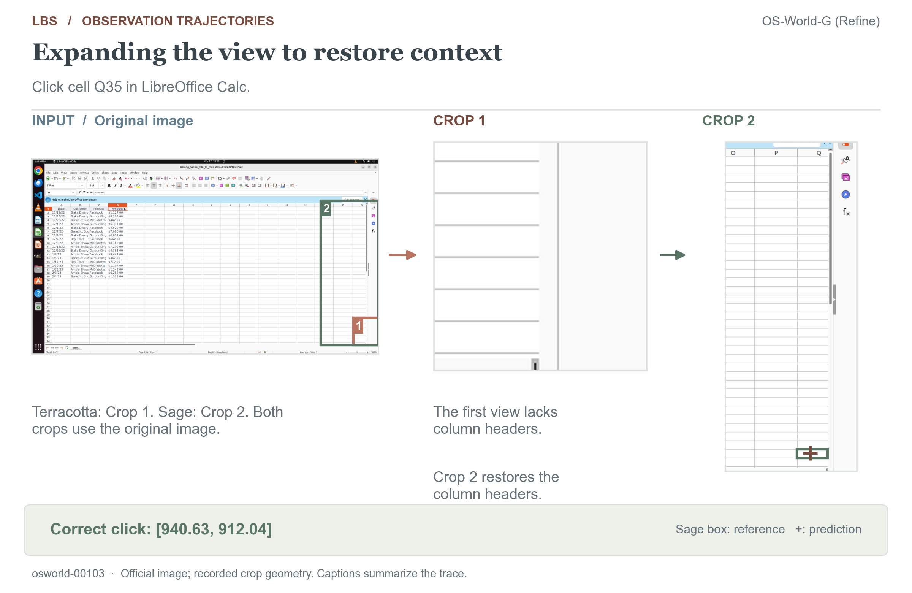
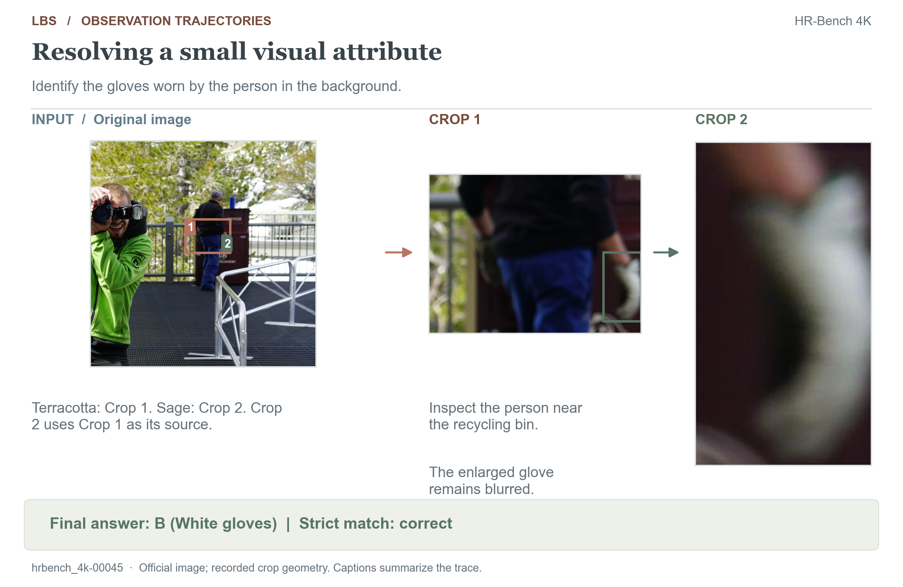

# Visually verified observation trajectories

The [HTML explorer](observation_trajectories.html) and static figures present six
reviewed cases from saved evaluations. Figures reconstruct crops from official
images and recorded tool events; no model inference or judging is repeated.
The crop executor verifies dimensions, parent-image rectangles, and mappings to
the original image. Reconstructions precede API JPEG encoding and do not claim
byte-identical reproduction of the original API payloads.

Captions and editorial analysis are separate from saved model text. Terracotta and
sage distinguish the first and second crops; target boxes and prediction crosses
are display annotations, never model inputs. A correct answer alone does not
establish that a crop was useful, as the blurred-glove example illustrates.

## Interactive HTML explorer

Open `docs/observation_trajectories.html` directly, or serve the repository root:

```bash
python3 -m http.server 8000
# Open http://localhost:8000/docs/observation_trajectories.html
```

The shipped viewer needs no build, model service, or downloaded dataset. Select a
case and turn to inspect the question, crop regions, returned images, reasoning,
and answer. Original previews fit within 1600 × 1600 pixels; reconstructed crops
retain their dimensions. Complete saved responses, sanitized source records,
scoring fields, and image hashes are available in the provenance disclosure.
Displayed reasoning removes only protocol wrappers and boundary whitespace.
Arrow keys, Home, and End navigate steps; Escape closes image inspection.

For GitHub Pages, select the `LBS` branch and `/docs` directory as the publishing
source. `index.html` redirects to the explorer, and `.nojekyll` preserves static
assets. GitHub's repository file view displays HTML source rather than running it.

### Preview and regenerate

Export viewer data and source snapshots, or check the existing export:

```bash
python3 scripts/export_trajectory_html.py
python3 scripts/export_trajectory_html.py --check
```

The check compares six records, saved response text, crop metadata, and 18 image
hashes. To reconstruct image assets, first download the official data and install
Pillow and Matplotlib, then run:

```bash
python3 scripts/export_trajectory_html.py --reconstruct-images
```

Reconstruction reuses the evaluation crop executor and writes only viewer assets,
source snapshots, and ignored `_work/` intermediates. Benchmark data remains
read-only. The HTML, CSS, and JavaScript are maintained separately from the export.

## Sources and evidence

These curated cases illustrate observation behavior and limitations; they are
not a random performance sample. The first four appear in the root README.

| Release ID | Official dataset | What the images confirm |
|---|---|---|
| `osworld-00344` | [OS-World-G (Refine)](https://github.com/xlang-ai/OSWorld-G), image `9S1Z75JVOM.png` | The first crop shows blue slide background; the second shows the yellow NOTE style. The final point is inside the reference box. |
| `sspro-00811` | [ScreenSpot-Pro](https://huggingface.co/datasets/likaixin/ScreenSpot-Pro), Quartus image `screenshot_2024-11-02_18-40-16.png` | The second crop uses the first crop as its parent and resolves the Programmer icon. The final point is inside the reference box. |
| `perceptionbench-00031` | [PerceptionBench](https://huggingface.co/datasets/moonshotai/PerceptionBench), record 31 | The two crops cover the upper/lower flowchart. There are 14 bordered modules; one has regular-weight text, leaving 13 with bold text. Both crops were requested in the same assistant turn. |
| `hrbench_8k-00132` | [HR-Bench](https://huggingface.co/datasets/DreamMr/HR-Bench), 8K record 132 | The initial crop shows sky and a column edge; the replacement crop contains the sundial with 1762 visible. Option A matches the reference under strict scoring. |
| `osworld-00103` | OS-World-G (Refine), image `kwbF3fkXnk.png` | The wider second crop restores O/P/Q headers. The final point is inside Q35's reference box. The model's claim that the first crop entirely missed Q is not adopted as a caption. |
| `hrbench_4k-00045` | HR-Bench, 4K record 45 | The nested crop isolates a light-colored glove. The image is blurred; enlarging it adds no new source detail. White gloves is the stored reference and the strict answer is correct. |

The remaining two cases illustrate context recovery and enlargement limits:



[Complete OS-World-G record](../benchmark_results/trajectories/osworld/osworld-00103.json)



[Complete HR-Bench record](../benchmark_results/trajectories/hrbench_4k/hrbench_4k-00045.json)

## Reconstruct the figures

After downloading benchmark data, run from the repository root:

```bash
pip install matplotlib  # Pillow is an evaluation dependency
python3 scripts/render_trajectories.py
```

The renderer writes PNG figures and
[geometry checks](assets/trajectories/reconstruction_checks.json) under
`docs/assets/trajectories/`, with temporary crops in the ignored `_work/` directory.
Geometry checks validate reconstruction; the case descriptions document the
separate visual review. Shared plotting style is defined in
[figure_style.py](../scripts/figure_style.py).

## Benchmark display scope

Benchmark excerpts are included solely to display recorded results and observation
trajectories, with no other use intended. Original ownership, licenses, and terms
remain unchanged. See [NOTICE](../NOTICE) for attribution and
[data use scope](LICENSE_AUDIT.md).
